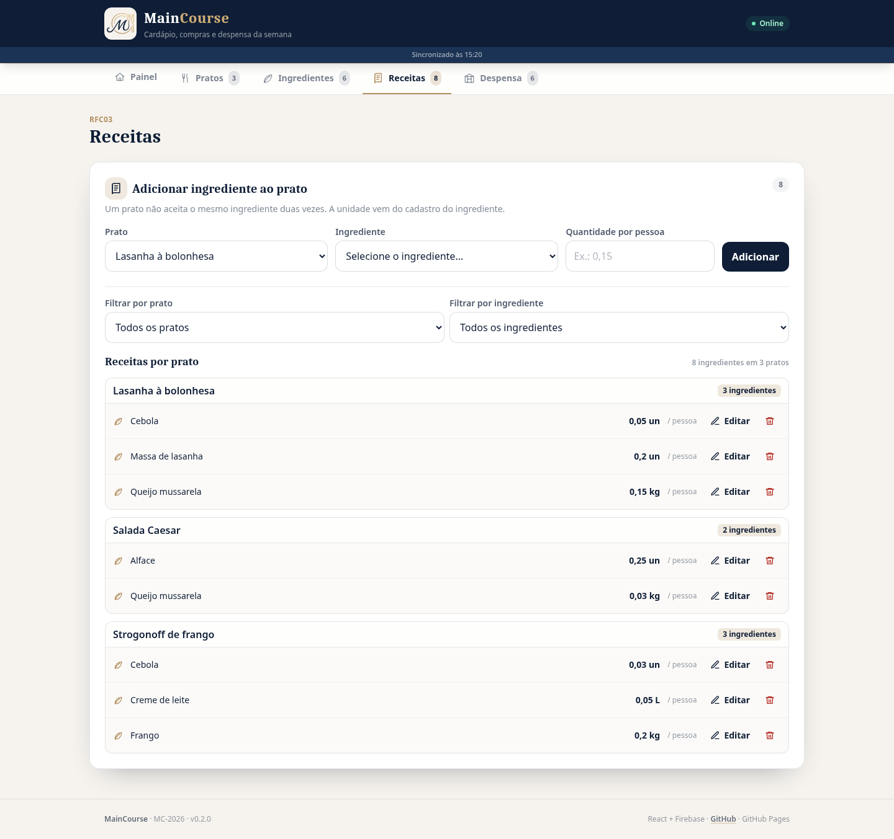

<p align="center">
  
</p>

<h1 align="center">MainCourse</h1>

<p align="center">
  Cardápio, compras e despensa da semana · projeto <strong>MC-2026</strong>
</p>

<p align="center">
  <a href="https://andreygregorio.github.io/MainCourse/"><strong>▶ Aplicação publicada</strong></a>
  ·
  <a href="docs/firebase.md">Guia do Firebase</a>
  ·
  <a href="docs/github-pages.md">Guia do GitHub Pages</a>
  ·
  <a href="docs/releases/r02.md">Notas da Release 2</a>
</p>

<p align="center">
  
  
  
  
  
</p>

---

## Sobre

O **MainCourse** organiza o cardápio da semana, a lista de compras e a despensa de uma casa. A
entrega é incremental, uma release por vez, como no cronograma da disciplina **SDES06 – Gerência de
Projetos de Software** (2026/2).

Esta é a **Release 2 (R02)**: as **receitas** — cada prato ligado aos seus ingredientes, com a
quantidade por pessoa — e a **despensa** por categoria. Os cadastros de pratos e ingredientes vieram
na R01; o cardápio da semana e a lista de compras automática entram na R03.

<p align="center">
  
</p>

<p align="center"><em>Prévia da Release 2.</em></p>

## O que já funciona (R02)

### Receitas e despensa — esta release

| Requisito | Entrega |
| --- | --- |
| **RFS09 a RFS12** | Incluir, consultar, alterar e excluir receitas: prato + ingrediente + quantidade **por pessoa**. O mesmo ingrediente não entra duas vezes; prato e ingrediente ficam bloqueados na edição. |
| **RFS13 a RFS16** | Incluir, consultar, alterar e excluir itens da despensa: nome, categoria (Limpeza, Salada, Temperos, Itens Gerais), quantidade (inclusive zero, para o que está em falta), unidade e observação. Nome único por categoria. |
| **RFS03, RFS04** | Renomear um prato atualiza as receitas; excluir o prato exclui as receitas junto, com aviso na confirmação. |
| **RFS07, RFS08** | Trocar a unidade do ingrediente acompanha os itens de despensa homônimos; excluir ingrediente usado em receita é bloqueado com o nome dos pratos. |
| **RNF002** | Navegação por teclado, rótulos em todos os campos, `aria-current` nas abas e diálogos próprios de confirmação. |
| **RNF012** | Código separado por domínio (`lib/acoes/pratos`, `ingredientes`, `receitas`, `despensa`) e suíte E2E ampliada (CT09 a CT16). |

### Base da Release 1

| Requisito | Entrega |
| --- | --- |
| **RFS01 a RFS04** | Incluir, consultar com busca, renomear e excluir pratos (com confirmação). |
| **RFS05 a RFS08** | Incluir, consultar por nome/unidade, alterar a unidade e excluir ingredientes. |
| **RNF001, RNF002** | Interface simples, responsiva e navegável por teclado/leitor de tela. |
| **RNF003, RNF004** | Dados em tempo real no Firestore e cache offline no aparelho. |
| **RNF007** | Escrita autenticada: o app cria uma sessão anônima antes de acessar o banco. |
| **RNF009** | Build estático publicado no GitHub Pages. |
| **RNF012** | Testes E2E com Selenium cobrindo o CRUD das quatro entidades. |

Também fazem parte da entrega:

- identidade visual MainCourse (logo, paleta, ícones e manifest PWA);
- navegação por seções com rota no hash e atalho do prato para a receita;
- painel inicial com os contadores das seções;
- workflow de deploy no GitHub Pages com as chaves vindas dos Secrets;
- regras do Firestore que exigem autenticação e validam os campos das quatro coleções;
- modo emulador do Firebase para rodar os testes sem tocar no banco de produção.

### O que ainda **não** entra

Cardápio da semana, lista de compras automática, resumo por unidade, exportação CSV e
compartilhamento. Esses itens estão na R03 e não aparecem na interface de propósito.

## Navegação

O app é uma única página com seções identificadas no endereço:

| Rota | Seção |
| --- | --- |
| `#/` ou `#/inicio` | Painel: contadores de pratos, ingredientes, receitas e despensa |
| `#/pratos` | Cadastro de pratos e atalho para a receita do prato |
| `#/ingredientes` | Cadastro de ingredientes e em quantas receitas cada um é usado |
| `#/receitas` | Receitas por prato, com filtros por prato e por ingrediente |
| `#/despensa` | Despensa por categoria, com filtros por categoria e nome |

A rota fica no hash porque o GitHub Pages só entrega arquivos estáticos — não há servidor para
responder a caminhos como `/receitas`. O endereço é compartilhável e o botão "voltar" do navegador
funciona.

## Testes

A suíte E2E fica em `tests/selenium/` (Selenium + pytest) e cobre os 22 casos de teste do MRB de
forma incremental:

- `test_r01.py` — página, abas, CRUD de pratos e de ingredientes (CT01 a CT08);
- `test_r02.py` — receitas e despensa (CT09 a CT16), bloqueio de exclusão de ingrediente em receita,
  renomeação e exclusão de prato com receitas;
- `apoio.py` — helpers comuns (rotas, esperas, criação e limpeza dos dados).

Os testes rodam contra uma instância publicada e **gravam/apagam registros reais**. Use o emulador
ou uma base de homologação:

```bash
# 1. Emuladores do Firebase (precisa de firebase-tools e Java)
firebase emulators:start --only firestore,auth --project demo-maincourse

# 2. App apontando para o emulador: VITE_USE_EMULATOR=true no .env.local
npm run dev

# 3. Testes (em outro terminal)
pip install -r tests/selenium/requirements.txt
BASE_URL=http://localhost:5173/ pytest tests/selenium
```

Contra o GitHub Pages (sem emulador):

```bash
BASE_URL=https://andreygregorio.github.io/MainCourse/ pytest tests/selenium
```

O workflow manual **E2E (Selenium)** (`.github/workflows/e2e.yml`) executa a suíte no Actions. Ele
não roda a cada push para não escrever no banco de produção sem necessidade.

## Stack

- **React 19 + TypeScript** com **Vite 8**;
- **Tailwind CSS 3** para o layout;
- **Firebase Authentication** (login anônimo) + **Cloud Firestore** com cache persistente;
- **GitHub Actions + GitHub Pages** para publicar o site estático;
- **Firebase Emulator Suite** (opcional) para testes locais sem tocar na produção.

### Por que Firebase? (e não um banco dentro do GitHub Pages)

O GitHub Pages só entrega **arquivos estáticos** (HTML, CSS, JS). Ele não executa backend, não abre
conexão com MySQL/Postgres e não guarda dados. Por isso o banco precisa ser um serviço externo.

O Firebase resolve as três necessidades do projeto sem servidor próprio:

1. **Firestore** é o banco de documentos, com atualização em tempo real;

2. o SDK funciona direto no navegador e mantém **cache offline** no IndexedDB;

3. o plano **Spark é gratuito** (sem cartão) para o volume de uma casa e de uma disciplina.

O passo a passo completo, do zero, está em [`docs/firebase.md`](docs/firebase.md).

## Rodando localmente

Pré-requisitos: **Node.js 22.12+** e uma conta Google para o Firebase.

```bash
git clone https://github.com/AndreyGregorio/MainCourse.git
cd MainCourse
npm install
cp .env.example .env.local
# edite o .env.local com as chaves do seu app Web no Firebase
npm run dev
```

Abra `http://localhost:5173`. Sem as chaves (ou sem o login anônimo ativo), o app permanece em
“Conectando...” e o detalhe técnico aparece apenas no console do navegador.

| Comando | O que faz |
| --- | --- |
| `npm run dev` | Servidor de desenvolvimento com HMR. |
| `npm run build` | Type-check (`tsc -b`) + build de produção em `dist/`. |
| `npm run preview` | Serve o `dist/` localmente. |
| `npm run lint` | ESLint. |
| `pytest tests/selenium` | E2E (com `BASE_URL` apontando para o app rodando). |

## Banco de dados no Firebase

1. Crie um projeto em <https://console.firebase.google.com/> (sugestão: `MainCourse MC-2026`).
2. **Firestore Database** → criar banco em modo de produção, região `southamerica-east1` (São Paulo).
3. **Authentication** → *Sign-in method* → ativar **Anônimo**.
4. **Authentication** → *Settings* → *Authorized domains* → adicionar `andreygregorio.github.io`
   (e `localhost`, que já vem).
5. **Firestore** → *Regras* → colar o conteúdo de [`firestore.rules`](firestore.rules) → publicar.
6. **Configurações do projeto** → *Seus apps* → app Web → copiar as chaves.

As coleções são criadas sozinhas no primeiro cadastro. O modelo desta release é:

```text
pratos/{id}                          → { nome }
ingredientes/{id}                    → { nome, unidade_medida }
receitas/{prato_id}::{ingrediente_id} → { prato_id, ingrediente_id, quantidade_por_pessoa }
despensa/{categoria}::{nome}          → { nome, categoria, quantidade, unidade_medida, observacao }
```

O `id` de pratos e ingredientes é o nome normalizado (minúsculo). Nas coleções novas, o `id` é
composto para garantir as regras de unicidade sem consulta extra:
`receitas/lasanha à bolonhesa::queijo mussarela` e `despensa/itens-gerais::arroz`.

Exemplo:

```json
// pratos/lasanha à bolonhesa
{ "nome": "Lasanha à bolonhesa" }

// ingredientes/queijo mussarela
{ "nome": "Queijo mussarela", "unidade_medida": "kg" }

// receitas/lasanha à bolonhesa::queijo mussarela
{ "prato_id": "lasanha à bolonhesa", "ingrediente_id": "queijo mussarela", "quantidade_por_pessoa": 0.15 }

// despensa/limpeza::detergente
{ "nome": "Detergente", "categoria": "Limpeza", "quantidade": 1, "unidade_medida": "un", "observacao": "armário de baixo" }
```

O arquivo [`firebase.json`](firebase.json) já configura os emuladores locais (Firestore na porta
8080 e Authentication na 9099) para os testes automatizados. Com `VITE_USE_EMULATOR=true` no
`.env.local`, o app usa os emuladores em vez do projeto real.

> **Guia detalhado, com solução de problemas e limites do plano gratuito:**
> [`docs/firebase.md`](docs/firebase.md).

## Publicando no GitHub Pages

O repositório precisa ser **público** para usar o GitHub Pages gratuitamente.

1. Crie o repositório `MainCourse` no GitHub.
2. Envie o código para a branch `main`.
3. Em **Settings → Pages → Build and deployment**, escolha **GitHub Actions** como source.
4. Em **Settings → Secrets and variables → Actions**, cadastre os secrets obrigatórios:

| Secret | Onde encontrar no Firebase |
| --- | --- |
| `VITE_FIREBASE_API_KEY` | `apiKey` do app Web |
| `VITE_FIREBASE_AUTH_DOMAIN` | `authDomain` |
| `VITE_FIREBASE_PROJECT_ID` | `projectId` |
| `VITE_FIREBASE_STORAGE_BUCKET` | `storageBucket` |
| `VITE_FIREBASE_MESSAGING_SENDER_ID` | `messagingSenderId` |
| `VITE_FIREBASE_APP_ID` | `appId` |
| `VITE_FIREBASE_MEASUREMENT_ID` | `measurementId` (opcional) |

5. Rode o workflow **Deploy no GitHub Pages** (Actions → Run workflow) ou faça um push na `main`.
6. A URL fica `https://andreygregorio.github.io/MainCourse/`.

O workflow [`deploy.yml`](.github/workflows/deploy.yml) calcula sozinho a subpasta do Pages
(`VITE_BASE=/MainCourse/`), roda `npm ci`, injeta os secrets no build e publica o `dist/`.

> **Passo a passo com tags, releases e erros comuns:**
> [`docs/github-pages.md`](docs/github-pages.md).

### Release como commit + tag

Cada entrega é um commit na `main` e uma tag `rXX`:

```bash
git add -A
git commit -m "feat(r02): receitas, despensa e navegação por seções"
git tag -a r02 -m "Release 2 — Receitas e despensa"
git push origin main
git push origin r02
gh release create r02 --title "Release 2 — Receitas e despensa" \
  --notes-file docs/releases/r02.md
```

## Estrutura

```text
.
├─ .github/workflows/deploy.yml   # build + deploy no GitHub Pages
├─ .github/workflows/e2e.yml      # E2E manual no Actions
├─ assets/                        # logo original e derivados
├─ docs/
│  ├─ firebase.md                 # criar o banco do zero (e emuladores)
│  ├─ github-pages.md             # publicar, tags e releases
│  └─ releases/r01.md, r02.md     # notas das releases
├─ public/                        # ícones, manifest, 404, .nojekyll
├─ tests/selenium/                # E2E: pytest + Selenium (apoio + r01 + r02)
├─ src/
│  ├─ App.tsx                     # login anônimo + providers
│  ├─ firebaseConfig.ts           # Firebase via env + modo emulador
│  ├─ components/
│  │  ├─ Aplicacao.tsx            # dados + ações + layout
│  │  ├─ Abas.tsx                 # navegação entre as seções
│  │  ├─ Cabecalho.tsx            # marca, online/offline e sincronização
│  │  ├─ TelaPainel.tsx           # escolhe a seção da rota
│  │  ├─ TelaCarregando.tsx
│  │  ├─ Logo.tsx
│  │  ├─ Rodape.tsx
│  │  ├─ painel/
│  │  │  ├─ PainelInicio.tsx
│  │  │  ├─ GestaoPratos.tsx
│  │  │  ├─ GestaoIngredientes.tsx
│  │  │  ├─ GestaoReceitas.tsx
│  │  │  └─ GestaoDespensa.tsx
│  │  └─ ui/                     # botão, campo, toast, confirmação, ícones
│  ├─ hooks/
│  │  ├─ useColecao.ts           # onSnapshot + online/offline
│  │  ├─ useDados.ts             # coleções ordenadas e agrupadas
│  │  ├─ useAcoes.ts             # ações + confirmação + avisos
│  │  └─ useRota.ts              # rotas no hash
│  ├─ lib/
│  │  ├─ acoes/                  # escritas por domínio (RNF012)
│  │  │  ├─ comum.ts             # validações, lotes e consultas
│  │  │  ├─ pratos.ts
│  │  │  ├─ ingredientes.ts
│  │  │  ├─ receitas.ts
│  │  │  └─ despensa.ts
│  │  ├─ constants.ts
│  │  ├─ env.ts                  # validação das variáveis do Firebase
│  │  ├─ mapeadores.ts
│  │  ├─ rotas.ts
│  │  └─ utils.ts                # ids, quantidades e mensagens
│  └─ types.ts
├─ firestore.rules
├─ firebase.json
├─ .env.example
└─ vite.config.ts
```

## Segurança

- As regras do Firestore exigem `request.auth != null`; o app cria uma sessão **anônima** ao abrir.
- O domínio do Pages precisa estar em **Authorized domains** no Authentication.
- A `apiKey` do Firebase é pública por natureza (vai no bundle); a proteção real são as regras e o
  domínio autorizado. Nunca coloque service account, senha ou chave privada no front-end.
- As regras validam os campos de cada coleção e impedem alterar o prato/ingrediente de uma receita
  e o nome de um item da despensa.
- **Limitação consciente:** qualquer pessoa com a URL consegue criar uma sessão anônima e escrever.
  Para um trabalho acadêmico com URL restrita, é aceitável. Em produção, o próximo passo seria
  Firebase App Check, autenticação por e-mail/link ou uma coleção por casa com `uid` no documento.

## Roadmap

| Release | Escopo | Status |
| --- | --- | --- |
| **R01** | Pratos e ingredientes (RFS01–RFS08) | ✅ entregue |
| **R02** | Receitas e despensa (RFS09–RFS16) | ✅ esta entrega |
| **R03** | Cardápio da semana e lista de compras (RFS17–RFS20, RF01 e RF02) | ⏳ próxima |
| **R04** | Homologação, ajustes finais e apresentação | ⏳ planejada |

## Solução de problemas

| Sintoma | Causa provável | Solução |
| --- | --- | --- |
| Site fica em “Conectando...” | Build sem as variáveis `VITE_FIREBASE_*`, login anônimo desligado ou banco inacessível. | Preencha o `.env.local` ou os Secrets, ative o login anônimo e gere um novo build/deploy. |
| Aviso “O banco de dados não respondeu” | Regras do Firestore antigas (sem `receitas`/`despensa`) ou sessão não criada. | Publique o `firestore.rules` desta release e clique em “Tentar de novo”. |
| Receitas ou despensa vazias e as demais seções funcionando | Regras publicadas são da R01. | Publique as regras novas. |
| `auth/operation-not-allowed` | Login anônimo desativado. | Authentication → Sign-in method → Anônimo → ativar. |
| `auth/unauthorized-domain` | Domínio fora da lista. | Authentication → Settings → Authorized domains → adicionar `andreygregorio.github.io`. |
| `permission-denied` | Regras não publicadas ou sessão ainda não criada. | Publique `firestore.rules` e recarregue. |
| Página branca no Pages | Caminho de base errado ou erro de JS. | Abra o console; confira `VITE_BASE` e os logs do workflow. |
| Ícones/JS 404 no Pages | Build feito com `VITE_BASE=/`. | Use o workflow oficial; ele define `/MainCourse/`. |
| Testes E2E falham ao abrir o navegador | Chrome/Chromium não encontrado. | Instale o Chrome ou defina `CHROME_BIN=/caminho/do/chromium`. |
| `npm ci` falha no Actions | `package-lock.json` desatualizado. | Rode `npm install`, commit o lock e envie. |

## Equipe e disciplina

Projeto da disciplina **SDES06 – Gerência de Projetos de Software** (2026/2), modelo SWFactory.

- **Andrey Gregorio** — gerente do projeto e desenvolvimento;
- **Lucas Oliveira** — análise;
- **Felipe Melo** e **Luiz Felipe** — desenvolvimento e QA.

Os artefatos da Release 0 (DRE, EST, CRO, MRB e Plano de Projeto) estão no repositório de documentos
do projeto, fora deste repositório de código.

## Licença

Projeto acadêmico e de uso pessoal. A marca e a logo **MainCourse** pertencem ao projeto; não
redistribua a identidade visual sem autorização.
