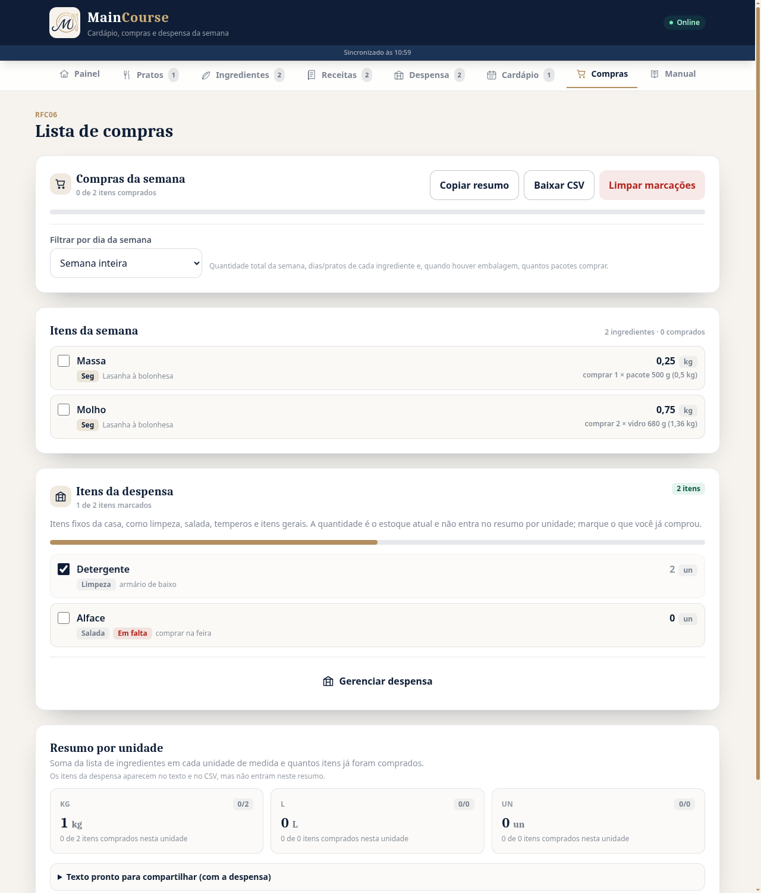

# Manual do usuário — MainCourse v0.4.0

**Projeto:** MC-2026 · MainCourse — cardápio, compras e despensa da semana
**Release:** R04 (versão 0.4.0)
**Aplicação:** <https://andreygregorio.github.io/MainCourse/>
**Manual dentro do app:** aba **Manual** (`#/manual`)
**Repositório:** <https://github.com/AndreyGregorio/MainCourse>

---

## Sumário

1. [O que é o MainCourse](#1-o-que-é-o-maincourse)
2. [Primeiros passos](#2-primeiros-passos)
3. [Painel](#3-painel)
4. [Pratos](#4-pratos)
5. [Ingredientes](#5-ingredientes)
6. [Receitas](#6-receitas)
7. [Despensa](#7-despensa)
8. [Cardápio](#8-cardápio)
9. [Compras](#9-compras)
10. [Manual dentro do app](#10-manual-dentro-do-app)
11. [Dicas de uso](#11-dicas-de-uso)
12. [Problemas comuns](#12-problemas-comuns)
13. [Privacidade e dados](#13-privacidade-e-dados)
14. [Glossário](#14-glossário)
15. [Versão e suporte](#15-versão-e-suporte)

---

## 1. O que é o MainCourse

O MainCourse organiza a comida da semana e a compra da casa. O fluxo principal é:

```text
Ingredientes → Pratos → Receitas → Cardápio → Compras
                                      ↓
                                  Despensa
```

- **Pratos** são os nomes que aparecem no cardápio.
- **Ingredientes** têm unidade de medida e, opcionalmente, embalagem de compra.
- **Receitas** ligam cada prato aos ingredientes e às quantidades.
- **Cardápio** escolhe um prato e o número de pessoas de segunda a sexta.
- **Compras** calcula a lista e permite marcar o que já foi comprado.
- **Despensa** guarda os itens fixos da casa; na R04 eles também aparecem em Compras.

O app não pede e-mail nem senha: ele cria uma sessão anônima no Firebase. Os dados ficam no
Cloud Firestore e sincronizam entre celular e computador. Sem internet, o app abre com o cache do
aparelho e sincroniza quando a conexão volta.



*Tela de Compras da R04: ingredientes do cardápio, itens da despensa e resumo por unidade.*

---

## 2. Primeiros passos

### 2.1 Abrir o app

1. Abra a URL da aplicação no navegador.
2. Aguarde a tela **“Conectando...”**; ela sai sozinha quando a sessão e as coleções carregam.

### 2.2 Navegar pelas abas

No topo da página ficam as abas:

**Painel · Pratos · Ingredientes · Receitas · Despensa · Cardápio · Compras · Manual**

Cada aba tem um endereço próprio no formato `#/compras`, `#/manual` etc. Isso permite salvar o
link, compartilhar e usar o botão “Voltar” do navegador.

### 2.3 Entender o indicador Online/Offline

- **Online**: o app está conectado e sincronizando.
- **Offline**: o app está usando os dados salvos no aparelho. Você pode continuar navegando; as
  alterações são enviadas quando a conexão volta.
- **Mostrando dados salvos no aparelho — sincronizando…**: o Firestore entregou primeiro o cache
  local e está buscando a versão mais nova.

### 2.4 Antes de começar

Para o fluxo completo funcionar, cadastre nesta ordem:

1. Ingredientes.
2. Pratos (com o rendimento).
3. Receitas (prato + ingrediente + quantidade).
4. Itens da despensa (opcional).
5. Cardápio da semana.
6. Abra Compras.

---

## 3. Painel

O Painel mostra os contadores de:

- pratos;
- ingredientes;
- receitas;
- itens da despensa;
- dias do cardápio;
- itens da lista de compras (ingredientes do cardápio + itens da despensa).

Clique em qualquer cartão para abrir a seção correspondente. O cartão **Compras** leva à lista
completa, inclusive à seção de itens da despensa.

---

## 4. Pratos

Um prato é o nome que aparece no cardápio. O nome é único: `Lasanha` e `lasanha` apontam para o
mesmo prato.

### 4.1 Incluir um prato

1. Abra **Pratos**.
2. Digite o nome (ex.: `Lasanha à bolonhesa`).
3. Informe **Rende (porções)**: quantas porções a receita inteira serve.
   - Use `1` quando a receita estiver escrita por pessoa.
   - Use `8` para uma travessa que serve 8 pessoas.
4. Clique em **Adicionar**.

### 4.2 Consultar e buscar

A lista fica em ordem alfabética. O campo de busca filtra por parte do nome e o selo de cada linha
mostra quantos ingredientes a receita tem (ou “Sem receita”).

### 4.3 Renomear

1. Clique em **Editar** na linha do prato.
2. Digite o novo nome.
3. Clique em **Salvar**.

Renomear atualiza as receitas e os dias do cardápio que usam o prato. O rendimento é preservado.

### 4.4 Excluir

1. Clique em **Excluir**.
2. Confirme no diálogo.

A exclusão é bloqueada se o prato estiver no cardápio: o app informa os dias e pede para removê-los
antes. Se o prato tiver receitas e não estiver no cardápio, as receitas são excluídas junto.

---

## 5. Ingredientes

Cada ingrediente tem nome, unidade (`kg`, `L` ou `un`) e, opcionalmente, embalagem de compra.

### 5.1 Incluir

1. Abra **Ingredientes**.
2. Digite o nome (ex.: `Queijo mussarela`).
3. Escolha a unidade usada na receita.
4. Se comprar em embalagem fechada, preencha:
   - **Embalagem**: rótulo livre, ex.: `pacote 500 g`, `vidro 680 g`, `dúzia`.
   - **Qtd. da embalagem**: quantidade na unidade do ingrediente. Para 500 g em um ingrediente
     `kg`, use `0,5`.
5. Clique em **Adicionar**.

### 5.2 Editar

O nome é a chave do cadastro e não muda. Na edição você pode alterar a unidade e a embalagem.

Ao trocar a unidade, a embalagem é limpa: a quantidade antiga estava na unidade anterior e deixaria
de fazer sentido. A nova unidade vale também para os itens de despensa com o mesmo nome.

### 5.3 Excluir

A exclusão é bloqueada se o ingrediente estiver em alguma receita. O app mostra os pratos; remova o
ingrediente dessas receitas antes de excluir.

---

## 6. Receitas

A receita liga um prato a um ingrediente e guarda a quantidade.

### 6.1 Incluir

1. Abra **Receitas**.
2. Escolha o prato.
3. Escolha o ingrediente. Um ingrediente não pode entrar duas vezes no mesmo prato.
4. Escolha o modo:
   - **Por pessoa**: a quantidade vale para uma pessoa; o app multiplica pelas pessoas do dia.
   - **Receita inteira**: a quantidade vale para o rendimento do prato; o app divide pelo
     rendimento e multiplica pelas pessoas.
5. Digite a quantidade e clique em **Adicionar**.

Exemplo: uma lasanha rende 8 porções e leva 0,5 kg de massa. Informando **Receita inteira** com
`0,5 kg`, um dia com 4 pessoas usa `0,25 kg`.

### 6.2 Consultar

A lista é agrupada por prato, com os ingredientes em ordem alfabética e o total de ingredientes de
cada prato. Os filtros permitem escolher um prato ou um ingrediente.

### 6.3 Editar e excluir

- **Editar**: só a quantidade muda; prato e ingrediente ficam bloqueados.
- **Excluir**: remove o vínculo, sem apagar o prato nem o ingrediente.

Alterar ou excluir uma receita recalcula a lista de compras automaticamente.

---

## 7. Despensa

A despensa guarda os itens fixos da casa nas categorias **Limpeza**, **Salada**, **Temperos** e
**Itens Gerais**. Ela serve para consulta e, na R04, também aparece no fim da tela de Compras.

### 7.1 Incluir

1. Abra **Despensa**.
2. Informe nome, categoria, quantidade e unidade.
3. A observação é opcional (marca, validade ou onde o item fica guardado).
4. Clique em **Adicionar**.

O mesmo nome pode existir em categorias diferentes, mas não se repete dentro da mesma categoria.

### 7.2 Consultar

A lista é agrupada pela ordem fixa das categorias e, dentro de cada uma, em ordem alfabética. Os
filtros permitem escolher a categoria e buscar pelo nome.

Quantidade `0` aparece com o selo **Em falta**.

### 7.3 Editar

O nome não muda. Os demais campos podem ser alterados; se a categoria mudar, o item muda de grupo.
Se o item estiver marcado como comprado em Compras, a marcação acompanha a mudança de categoria.

### 7.4 Excluir

A exclusão remove o item da despensa e a marcação de compra dele. A lista de ingredientes do
cardápio não é alterada.

---

## 8. Cardápio

O cardápio cobre de segunda a sexta, com um prato por dia e o número de pessoas.

### 8.1 Planejar um dia

1. Abra **Cardápio**.
2. Escolha o dia, o prato e o número de pessoas.
3. Clique em **Planejar**.

Só aparecem na escolha os pratos que têm pelo menos um ingrediente na receita.

### 8.2 Consultar

A semana aparece na ordem de segunda a sexta. Cada dia mostra o prato, as pessoas e o total de
ingredientes. O filtro por dia mostra só o dia escolhido. Dias livres aparecem como “Livre”.

### 8.3 Editar

1. Clique em **Editar** no dia.
2. Troque o prato e/ou as pessoas.
3. Clique em **Salvar**.

O dia é imutável na edição: para mudar de dia, exclua o registro e crie outro.

### 8.4 Excluir

Excluir um dia libera a data e remove os ingredientes daquele dia da lista de compras. O prato e a
receita continuam cadastrados.

---

## 9. Compras

A tela de Compras tem duas partes:

1. **Lista de ingredientes** — calculada a partir do cardápio e das receitas.
2. **Itens da despensa** — checklist dos itens fixos da casa (novidade da R04).

### 9.1 Lista de ingredientes

Cada linha mostra:

- nome do ingrediente;
- quantidade total no período;
- unidade;
- dias e pratos em que é usado;
- embalagens a comprar, quando o ingrediente tem embalagem cadastrada.

Exemplo: `0,75 kg` de queijo, usado na segunda e na quarta, com a indicação “comprar 2 × pacote
500 g (1 kg)”.

O filtro por dia recalcula as quantidades para o dia escolhido. **Semana inteira** é o padrão.

### 9.2 Marcar o que já foi comprado

1. Clique na caixa ao lado do item.
2. O item fica riscado e entra no progresso.
3. Para desmarcar, clique de novo.

As marcações ficam no Firestore e acompanham o usuário entre aparelhos.

### 9.3 Resumo por unidade

O resumo soma os ingredientes em `kg`, `L` e `un`, com o total de itens e de itens já comprados em
cada unidade. É um total de conferência, não uma conversão de medidas.

### 9.4 Itens da despensa

No fim da tela aparece a seção **Itens da despensa**, com todos os itens cadastrados, a categoria, a
quantidade, a unidade e a observação.

- A caixa de seleção é **separada** da lista de ingredientes.
- A quantidade é o **estoque atual**, não a necessidade do cardápio.
- Os itens da despensa **não entram no resumo por unidade**.
- Eles entram no **texto compartilhado** e no **CSV**.
- O botão **Limpar marcações** desmarca ingredientes e itens da despensa de uma vez.
- Se um item estiver com quantidade `0`, ele aparece como **Em falta** e pode ser marcado mesmo
  assim.

Para cadastrar ou editar, use o botão **Gerenciar despensa** ou a aba **Despensa**.

### 9.5 Compartilhar

- **Copiar resumo**: copia o texto da lista (ingredientes + despensa) para a área de transferência.
- **Baixar CSV**: baixa um arquivo compatível com Excel pt-BR, com a coluna `Origem` distinguindo
  `Cardápio` e `Despensa`.
- **Texto pronto para compartilhar**: mostra uma prévia do texto antes de copiar.

### 9.6 Limpar marcações

O botão **Limpar marcações** pede confirmação e desmarca todos os itens (ingredientes e despensa).
A lista em si não muda: os itens continuam na tela, apenas voltam a ficar pendentes.

---

## 10. Manual dentro do app

A aba **Manual** (`#/manual`) repete este guia em uma versão navegável, com índice e atalhos para as
seções. Ela funciona offline depois do primeiro carregamento, como o restante do app.

Use o índice para ir direto a um assunto ou os botões do fim da página para abrir **Cardápio**,
**Compras** ou **Despensa**.

---

## 11. Dicas de uso

- Cadastre a embalagem (pacote, vidro, lata) para a lista dizer quantos volumes comprar.
- Use o rendimento do prato para receitas escritas para a travessa inteira.
- Itens com quantidade zero na despensa aparecem como “Em falta” e podem ser marcados na compra.
- Em celular, o layout se adapta e as abas ficam em duas linhas.
- Sem internet, o app abre com o cache; as alterações são sincronizadas quando a conexão volta.
- Abra o app em outro aparelho com a mesma URL para ver os dados atualizados em tempo real.
- Use o filtro por dia para conferir a compra de um dia específico sem perder a visão da semana.

---

## 12. Problemas comuns

| Sintoma | Causa provável | O que fazer |
| --- | --- | --- |
| `permission-denied` ao abrir uma seção | Regras antigas ou coleção nova ainda não liberada. | Publique o `firestore.rules` da R04 (inclui `compras_despensa`). |
| Não consigo excluir um prato | O prato está no cardápio. | Remova os dias do cardápio antes. |
| Não consigo excluir um ingrediente | O ingrediente está em uma receita. | Remova o ingrediente das receitas indicadas. |
| A marcação da despensa não responde | Falha momentânea de conexão ou regras antigas. | Verifique o indicador Online/Offline e tente de novo. |
| O texto copiado não inclui a despensa | A lista estava vazia ou a seção não carregou. | Confira se há itens na despensa e recarregue a página. |
| O CSV abre com colunas trocadas | Separador ou codificação do Excel. | Use “Dados → Texto para colunas” com `;` e UTF-8. |

---

## 13. Privacidade e dados

- O acesso usa **login anônimo** do Firebase Authentication: não há nome, e-mail ou senha.
- Os dados ficam no **Cloud Firestore** do projeto e são compartilhados por quem tem a URL e a
  sessão do app.
- Não há perfis separados por usuário nesta versão.
- O plano gratuito do Firebase não tem backup automático. Para guardar uma cópia, use o CSV da
  lista ou exporte os dados pelo console do Firebase.
- O app não coleta dados de pagamento, localização ou contatos.

---

## 14. Glossário

| Termo | Significado |
| --- | --- |
| **Prato** | Nome que aparece no cardápio; pode ter uma receita. |
| **Ingrediente** | Item usado na receita, com unidade e embalagem opcional. |
| **Receita** | Vínculo entre prato e ingrediente, com quantidade. |
| **Rendimento** | Quantas porções a receita inteira serve. |
| **Por pessoa** | Quantidade da receita para uma pessoa. |
| **Receita inteira** | Quantidade da receita completa, para o rendimento do prato. |
| **Embalagem** | Volume de compra (pacote, vidro, lata) e sua quantidade na unidade do ingrediente. |
| **Despensa** | Estoque fixo da casa, em quatro categorias. |
| **Cardápio** | Prato e número de pessoas de segunda a sexta. |
| **Lista de compras** | Ingredientes calculados a partir do cardápio e das receitas. |
| **Marcação** | Indicação de que um item já foi comprado. |

---

## 15. Versão e suporte

- **Versão:** 0.4.0 (Release 4).
- **Aplicação:** <https://andreygregorio.github.io/MainCourse/>
- **Repositório:** <https://github.com/AndreyGregorio/MainCourse>
- **Suporte:** contate o grupo **MainCourse** pelo link do GitHub acima.
- **Notas da release:** [`docs/releases/r04.md`](releases/r04.md)
- **Guia do Firebase:** [`docs/firebase.md`](firebase.md)
- **Guia do Firebase Hosting:** [`docs/firebase-hosting.md`](firebase-hosting.md)

Para reportar um problema, anote a tela, a ação e a mensagem exibida. Se possível, tire uma captura
de tela antes de recarregar a página. Envie o relato aos desenvolvedores do projeto pelo GitHub.
