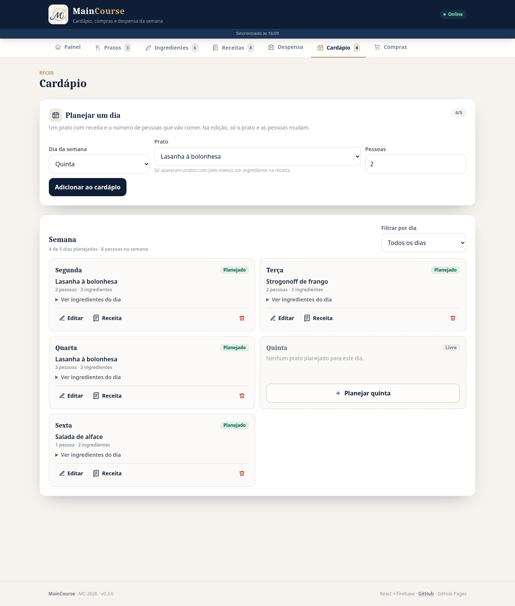
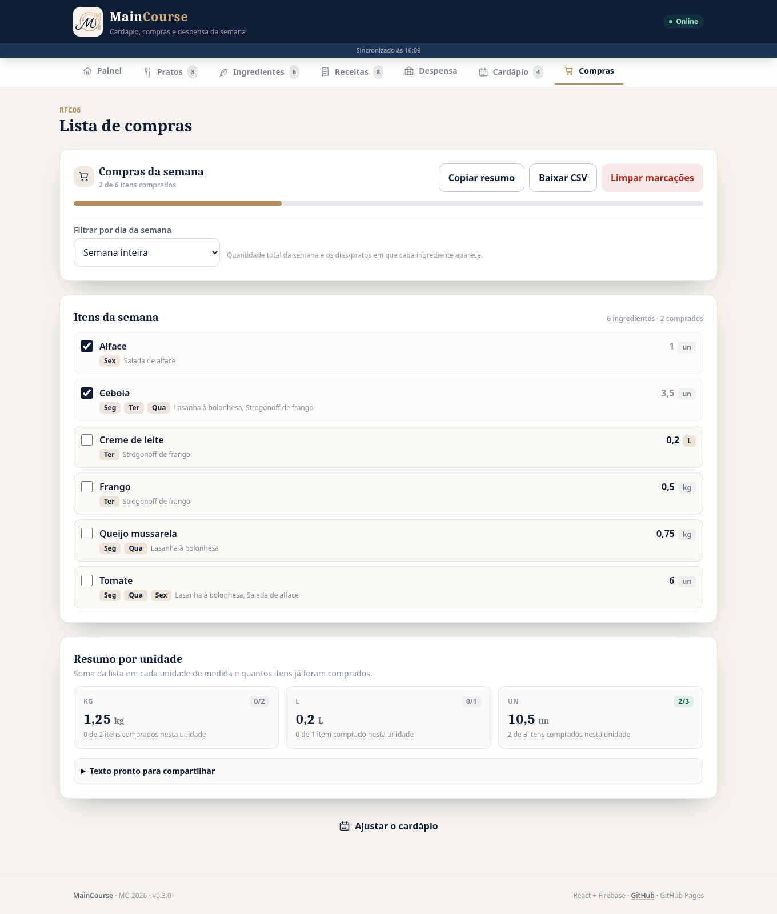

# Release 3 — Cardápio e lista de compras (R03)

**Projeto:** MC-2026 · MainCourse — cardápio, compras e despensa da semana
**Data:** 12/11/2026 · data prevista no cronograma: 24/08/2026 (pacote 6.1–6.2)
**Tag:** `r03`
**Commit sugerido:** `feat(r03): cardápio da semana e lista de compras`

---

## Resumo

A Release 3 fecha o fluxo principal do produto: o usuário monta o **cardápio de segunda a sexta**
com o prato e o número de pessoas de cada dia e o sistema **calcula a lista de compras da semana**
somando, por ingrediente, `quantidade por pessoa × pessoas do dia`. A partir da lista, é possível
marcar o que já foi comprado, limpar as marcações, ver o **resumo por unidade** e copiar um texto
pronto para compartilhar.

Com isso, o cadastro da R01 e as receitas/despensa da R02 deixam de ser ilhas: a receita vira
compra, e a despensa continua sendo consulta (o DRE não manda descontá-la da lista).



*Cardápio: um prato com receita e o número de pessoas por dia, com os ingredientes do dia.*



*Lista de compras: quantidades, dias, pratos, marcações e resumo por unidade.*

## Escopo entregue

### Cardápio — RFS17 a RFS20

| Requisito | Entrega |
| --- | --- |
| **RFS17 Incluir Dia do cardápio** | Escolha do dia (segunda a sexta, um registro por dia), prato **com receita** e número inteiro de pessoas maior ou igual a 1. Prato sem receita não aparece na escolha. |
| **RFS18 Consultar Dia do cardápio** | Semana em ordem de segunda a sexta, com filtro por dia, prato, pessoas e a lista de ingredientes do dia com a quantidade total (`por pessoa × pessoas`). Dias livres aparecem como tal. |
| **RFS19 Alterar Dia do cardápio** | O dia é imutável na edição; só prato e pessoas mudam. Trocar qualquer um recalcula a lista de compras. |
| **RFS20 Excluir Dia do cardápio** | Confirmação própria; o dia volta a ficar livre e os ingredientes daquele dia saem do cálculo da lista. |

### Lista de compras — RF01 e RF02

| Requisito | Entrega |
| --- | --- |
| **RF01 Lista de compras da semana** | Uma linha por ingrediente com a quantidade total, a unidade, os dias e os pratos em que é usado; filtro por dia (semana inteira por padrão); ordenação alfabética; marcação de comprado por item e limpeza de todas as marcações. |
| **RF02 Resumo por unidade** | Totalização em `kg`, `L` e `un`, com a quantidade de itens e de itens já comprados em cada unidade; texto pronto para compartilhar e exportação em CSV. |

### Reflexos nos cadastros anteriores

- **RFS03:** renomear um prato migra, no mesmo lote, as receitas e os dias do cardápio que apontam
  para ele.
- **RFS04:** excluir um prato usado no cardápio é bloqueado com os dias na mensagem; o usuário
  libera os dias antes. As receitas continuam sendo excluídas junto com o prato quando não há
  cardápio.
- **RFS08:** excluir um ingrediente remove também a marcação de compra dele (`compras`).
- **RFS11/RFS12:** alterar ou excluir uma receita recalcula a lista automaticamente, porque a
  lista é derivada do cardápio + receitas.

### Interface e infraestrutura

- Duas seções novas na navegação: **Cardápio** e **Compras**.
- Painel com seis contadores: pratos, ingredientes, receitas, despensa, dias planejados e itens da
  lista.
- Marcações de compra persistidas no Firestore (`compras`), sincronizadas entre celular e
  computador e com atualização em tempo real.
- Motor de cálculo puro em [`src/lib/listaCompras.ts`](../../src/lib/listaCompras.ts), sem estado e
  sem acesso ao banco, usado pela tela, pelo painel e pelo texto/CSV.
- Regras do Firestore para `cardapio` e `compras`, com validação de dia, pessoas, referência e
  timestamp.
- Testes E2E novos (CT17 a CT22) em `tests/selenium/test_r03.py`, mais helpers de cardápio/compras
  em `apoio.py`.

## Sobre o RF02 nesta release

O Plano de Projeto reservava o RF02 para a R04. O cronograma aprovado desta entrega, no entanto,
coloca **a lista de compras e o resumo por unidade na R03**; por isso o RF02 foi implementado agora,
com a R04 ficando para homologação, manual do usuário e termo de aceite. Os dois requisitos são de
prioridade importante, e a antecipação não muda o escopo dos cadastros.

## Como testar

### Pré-requisito obrigatório

Publique o [`firestore.rules`](../../firestore.rules) desta release (Firestore → Regras → Publicar).
Sem as regras de `cardapio` e `compras`, as seções novas mostram o aviso de banco e não gravam.

### Local

```bash
npm install
cp .env.example .env.local   # preencha com as chaves do Firebase
npm run dev
```

Roteiro:

1. **Pratos/Ingredientes/Receitas:** monte ao menos dois pratos com receita (ex.: lasanha com
   queijo, tomate e cebola; strogonoff com frango, creme de leite e cebola).
2. **Cardápio:** planeje segunda com a lasanha para 2 pessoas e quarta com a lasanha para 3.
   Confira:
   - o prato sem receita não aparece na escolha;
   - o dia já planejado não volta ao formulário de inclusão;
   - os ingredientes do dia mostram a quantidade por pessoa × pessoas;
   - editar o dia mantém o dia bloqueado e permite trocar prato/pessoas;
   - excluir o dia devolve o dia para a lista de livres.
3. **Compras:** confira a quantidade total (ex.: queijo `0,15 × 2 + 0,15 × 3 = 0,75 kg`), os dias e
   os pratos de cada ingrediente.
4. **Filtro por dia:** escolha “Segunda” e confira que a quantidade passa a ser só a do dia.
5. **Marcações:** marque dois itens, veja o progresso e o resumo por unidade; abra o texto pronto
   para compartilhar; clique em **Limpar marcações** e confirme que tudo volta a pendente.
6. **Reflexos:** renomeie a lasanha e confira o cardápio; tente excluir o prato usado no cardápio e
   veja o bloqueio com os dias; libere os dias e exclua.

### Testes automatizados

```bash
# E2E contra o app em execução (grava e apaga registros reais)
BASE_URL=http://localhost:5173/ pytest tests/selenium
```

Sem tocar no banco de produção, com o emulador local:

```bash
firebase emulators:start --only firestore,auth --project demo-maincourse
# em outro terminal, com VITE_USE_EMULATOR=true no .env.local:
npm run dev
BASE_URL=http://localhost:5173/ pytest tests/selenium
```

Para rodar só a Release 3:

```bash
BASE_URL=http://localhost:5173/ pytest tests/selenium/test_r03.py
```

## Decisões técnicas

- **Um documento por dia, id = dia normalizado.** `cardapio/{segunda}` garante “um único registro
  por dia” (RFS17) sem consulta extra. O dia é imutável (RFS19), então o id nunca muda; prato e
  pessoas são os únicos campos editáveis.
- **Cardápio guarda referência, não cópia.** O dia guarda `prato_id`; nome, receita e unidade vêm
  sempre do cadastro atual. Renomear o prato atualiza o `prato_id` dos dias no mesmo lote da
  renomeação.
- **Lista calculada, não persistida.** A lista é uma função pura de cardápio + receitas +
  ingredientes; nada é gravado no Firestore para ela. Isso evita dado duplicado/desatualizado e
  atende ao RNF003 (mesma entrada, mesma saída).
- **Quantidade do período.** No filtro “semana inteira”, a quantidade é a soma dos dias; no filtro
  por dia, é a quantidade daquele dia. A tela deixa o período explícito no título e na legenda.
- **Marcação no Firestore.** `compras/{ingrediente_id}` é criado ao marcar e apagado ao desmarcar.
  Fica no banco (e não só no `localStorage`) para acompanhar o usuário entre aparelhos e para o
  RFS08 remover a marcação junto com o ingrediente.
- **A despensa não desconta.** O RF01 define a quantidade como `por pessoa × pessoas`; a despensa é
  consulta separada. O RFS16 reforça que excluir um item da despensa não altera a lista.
- **Prato sem receita.** O RFS17 impede escolher um prato sem receita. Se a última receita de um
  prato já usado no cardápio for removida depois, o dia continua no cardápio, mas mostra um aviso e
  não gera itens na lista; o usuário pode trocar o prato ou remover o dia.
- **Sem data e sem turno.** O DRE modela o cardápio por **dia da semana** (RFS17/RFS18), não por
  data/refeição; a orientação é seguida ao pé da letra.

## Atualização em produção

1. Publique o `firestore.rules` atualizado (obrigatório — sem isso Cardápio/Compras ficam
   bloqueados).
2. Faça o deploy normal pelo workflow (push na `main` ou execução manual).
3. Não há migração: `pratos`, `ingredientes`, `receitas` e `despensa` continuam iguais;
   `cardapio` e `compras` são criadas no primeiro uso.
4. Se a base tiver dados de demonstração, apague os dias do cardápio antes de mostrar o app.

## Limitações conhecidas

- O cardápio cobre segunda a sexta e um prato por dia, como no DRE; não há almoço/jantar separados
  nem datas.
- A lista não desconta a despensa e não soma perdas (o glossário do DRE cita necessidade líquida,
  mas o RF01 define a quantidade sem estoque e sem perda).
- As marcações são por ingrediente, não por semana; limpar as marcações vale para a lista atual.
- O resumo por unidade soma ingredientes diferentes na mesma unidade (ex.: `kg`), como pede o RF02;
  ele é um total de conferência, não uma conversão de medidas.
- O texto para compartilhar usa a área de transferência; em navegador antigo sem Clipboard API há
  uma alternativa via `textarea`.
- Os testes E2E gravam e apagam registros reais; use o emulador ou uma base de homologação.

## Próxima release

**R04 — Homologação e encerramento:** revisão dos requisitos com a matriz de rastreabilidade,
manual do usuário, ajustes finais de usabilidade, publicação da versão de produção e termo de
aceite. O RF02, previsto originalmente para a R04, já foi entregue na R03 conforme o cronograma.

## Links

- Aplicação: <https://andreygregorio.github.io/MainCourse/>
- Repositório: <https://github.com/AndreyGregorio/MainCourse>
- Guia do Firebase: [`docs/firebase.md`](../firebase.md)
- Guia do Pages: [`docs/github-pages.md`](../github-pages.md)
- Notas da R01: [`docs/releases/r01.md`](r01.md)
- Notas da R02: [`docs/releases/r02.md`](r02.md)
