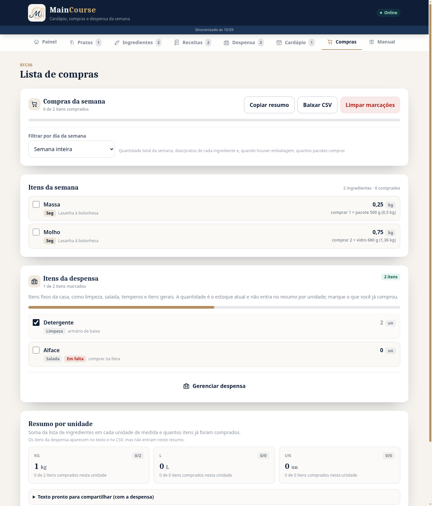
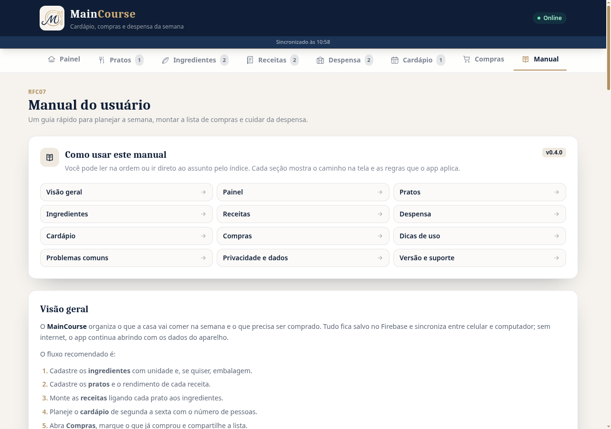

# Release 4 — Homologação, manual e encerramento (R04)

**Projeto:** MC-2026 · MainCourse — cardápio, compras e despensa da semana
**Data:** 13/11/2026
**Versão:** 0.4.0
**Tag:** `r04`
**Commit sugerido:** `feat(r04): despensa na lista, manual do usuário e publicação`

---

## Resumo

A Release 4 fecha o projeto. Ela consolida a mudança de rendimento e embalagem (SM-01), acrescenta
os **itens da despensa na lista de compras** com marcação própria (SM-02 / RF03), entrega o
**manual do usuário dentro do app** (RFC07) e conclui a publicação, a homologação, o termo de aceite
e o encerramento com as lições aprendidas.

Com isso, o MainCourse cobre o ciclo completo da casa: cadastrar ingredientes e pratos, montar
receitas, planejar a semana, calcular a compra, marcar o que já foi comprado — inclusive os itens
fixos da despensa — e consultar o manual sem sair do app.



*Lista de compras: ingredientes do cardápio, seção da despensa com marcação própria e resumo por
unidade.*



*Manual do usuário: nova aba com índice, passo a passo e atalhos.*

## Escopo entregue

### SM-01 — Rendimento da receita e embalagem de compra

- `pratos.porcoes_base`: quantas porções a receita inteira rende (1 a 99).
- `receitas.quantidade`: quantidade da receita inteira; a tela oferece **Por pessoa** ou **Receita
  inteira**.
- `ingredientes.embalagem`: rótulo e quantidade na unidade do ingrediente, para a lista dizer
  quantas embalagens comprar.
- Lista, texto e CSV com a informação de compra por embalagem.
- Compatibilidade com dados da R03 (leitura tolerante do campo antigo).

Detalhes em [`sm-01-rendimento-embalagem.md`](sm-01-rendimento-embalagem.md).

### RF03 — Itens da despensa na lista de compras (SM-02)

- Nova seção **Itens da despensa** na tela de Compras, com todos os itens cadastrados.
- Caixa de seleção própria, com progresso separado e persistência no Firestore.
- Coleção `compras_despensa`, separada de `compras` para não colidir com ids de ingredientes.
- **Limpar marcações** desmarca ingredientes e despensa de uma vez.
- Texto compartilhado e CSV incluem a despensa, com a coluna `Origem`.
- Resumo por unidade continua só com os ingredientes (RF02).
- Excluir item da despensa remove a marcação; mudar de categoria move a marcação.
- Itens aparecem mesmo quando o cardápio está vazio.

Detalhes em [`sm-02-despensa-na-lista.md`](sm-02-despensa-na-lista.md).

### RFC07 — Manual do usuário na aplicação

- Nova aba **Manual** (`#/manual`), com índice e doze tópicos: visão geral, painel, pratos,
  ingredientes, receitas, despensa, cardápio, compras, dicas, problemas comuns, privacidade e
  versão.
- Conteúdo em português, com passo a passo, exemplos, glossário e perguntas frequentes.
- O mesmo conteúdo, em formato de documento, está em
  [`docs/manual-do-usuario.md`](../manual-do-usuario.md).
- Link para o manual no rodapé e atalhos para Cardápio, Compras e Despensa.

### Publicação no Firebase Hosting

- `firebase.json` com a configuração de `hosting` (`dist`, rewrite para `index.html`).
- Workflow manual **Deploy no Firebase Hosting**, com build em `VITE_BASE=/`.
- Guia passo a passo em [`docs/firebase-hosting.md`](../firebase-hosting.md).
- O GitHub Pages continua disponível como publicação contínua; o Firebase Hosting é a entrega
  oficial da R04 quando as credenciais forem configuradas.

### Homologação, aceite e encerramento

- [`docs/homologacao.md`](../homologacao.md): roteiro de testes, critérios de aceite, registro de
  evidências e defeitos.
- [`docs/termo-de-aceite.md`](../termo-de-aceite.md): termo formal com escopo, condições e
  assinaturas.
- [`docs/encerramento.md`](../encerramento.md): entrega final, métricas, lições aprendidas e
  encerramento do projeto.
- [`docs/gerencia/monitoramento-e-controle.md`](../gerencia/monitoramento-e-controle.md): revisões
  de marcos de agosto a novembro, indicadores e riscos.
- [`docs/gerencia/controle-de-mudancas.md`](../gerencia/controle-de-mudancas.md): triagem, análise,
  aprovação e comunicação das mudanças SM-01 e SM-02.

## Requisitos novos da R04

| Requisito | Descrição | Onde |
| --- | --- | --- |
| **RF03** | Itens da despensa visíveis e marcáveis na lista de compras, com texto e CSV próprios. | Tela de Compras / `compras_despensa` |
| **RFC07** | Manual do usuário dentro do app, com índice e conteúdo de uso. | Aba Manual / `docs/manual-do-usuario.md` |

## Matriz de rastreabilidade (resumo)

| Requisito | Entrega | Teste |
| --- | --- | --- |
| RFS01–RFS04 | Pratos | CT01–CT04 |
| RFS05–RFS08 | Ingredientes | CT05–CT08 |
| RFS09–RFS12 | Receitas | CT09–CT12 |
| RFS13–RFS16 | Despensa | CT13–CT16 |
| RFS17–RFS20 | Cardápio | CT17–CT20 |
| RF01 | Lista de compras | CT21 |
| RF02 | Resumo por unidade | CT22 |
| RF03 | Despensa na lista | **CT26** |
| RFC07 | Manual do usuário | **CT27** |
| SM-01 | Rendimento e embalagem | CT23–CT25 |

A matriz completa está em [`docs/matriz-de-rastreabilidade.md`](../matriz-de-rastreabilidade.md).

## Como testar

### Local

```bash
npm install
cp .env.example .env.local   # preencha com as chaves do Firebase
npm run dev
```

Roteiro rápido:

1. **Despensa:** cadastre `Detergente` (Limpeza, 2 un) e `Alface` (Salada, 0 un).
2. **Compras:** confira a seção **Itens da despensa**; marque o detergente e veja o progresso.
3. Saia e volte para Compras; a marcação deve continuar.
4. Clique em **Limpar marcações** e confirme que os dois itens (ingredientes e despensa) voltam a
   pendente.
5. **Manual:** abra a aba Manual, use o índice e confira o tópico de Compras.
6. **SM-01:** crie uma lasanha que rende 8 porções com 0,5 kg de massa; um dia com 4 pessoas deve
   gerar 0,25 kg na lista.
7. **Embalagem:** cadastre um molho de 1,5 kg em vidros de 0,68 kg; a lista deve mostrar
   “comprar 3 × vidro 680 g (2,04 kg)”.

### Testes automatizados

```bash
# suíte completa, isolada no emulador
firebase emulators:start --only firestore,auth --project demo-maincourse
VITE_USE_EMULATOR=true npm run dev   # outro terminal
BASE_URL=http://localhost:5173/ pytest tests/selenium

# só a R04
BASE_URL=http://localhost:5173/ pytest tests/selenium/test_r04.py
```

A suíte completa tem 30 testes (27 casos de teste, a carga da página e a fumaça do site). O workflow **E2E (Selenium)** roda no
emulador a cada push na `main` e em pull requests.

### Verificação usada nesta entrega

- `npm run build` — concluído.
- `npm run lint` — concluído sem avisos.
- `python3 -m py_compile tests/selenium/apoio.py tests/selenium/test_r04.py` — concluído.
- Verificação direta do motor da lista (cálculo, texto e CSV com despensa) — concluída.
- Suíte E2E completa no emulador do Firebase com Chrome headless: **30 testes passaram**,
  incluindo CT26 e CT27, em 10/11/2026. O roteiro está no
  [`tests/selenium/README.md`](../../tests/selenium/README.md) e no workflow do GitHub Actions.

## Decisões técnicas

- **Coleção separada para a despensa.** `compras_despensa` evita colisão entre o id composto da
  despensa (`categoria::nome`) e o id de um ingrediente, mantém as regras simples e não exige
  migração.
- **Despensa não entra no cálculo.** A necessidade do cardápio e o estoque da casa são conceitos
  diferentes. O resumo por unidade continua sendo a conferência do RF02.
- **Marcação move com a categoria.** O id do item muda quando a categoria muda; a marcação é movida
  no mesmo lote para o item não parecer desmarcado.
- **Manual como conteúdo estático.** A aba não depende de Firestore: funciona offline, não gasta
  leituras e pode ser atualizada junto com o build. O documento equivalente fica em `docs/`.
- **Publicação em duas frentes.** O Pages continua sendo o deploy contínuo; o Firebase Hosting é a
  entrega oficial da R04, com workflow manual e guia de configuração.
- **Firebase Hosting na raiz.** O build do Hosting usa `VITE_BASE=/`; o build do Pages continua
  usando `VITE_BASE=/MainCourse/` definido pelo workflow.

## Publicação e atualização em produção

### Ordem recomendada

1. **App 0.4.0:** push na `main` (Pages) ou execução do workflow do Firebase Hosting.
2. **Regras do Firestore:** publique `firestore.rules` (inclui `compras_despensa`).
3. **Domínios no Authentication:** adicione `<PROJECT_ID>.web.app` e
   `<PROJECT_ID>.firebaseapp.com` se for usar o Hosting.
4. **Conferência:** abra a URL publicada, cadastre um item de despensa e marque-o em Compras.
5. **Homologação:** siga [`docs/homologacao.md`](../homologacao.md) e assine o termo.

### Por que o app antes das regras

A versão anterior do app grava `porcoes_base` e `embalagem`, que as regras novas exigem. Publicar o
app novo primeiro evita que a versão antiga seja recusada. A marcação da despensa só funciona depois
que as regras novas estiverem no ar.

## Limitações conhecidas

- O cardápio cobre segunda a sexta, um prato por dia; não há almoço/jantar separados nem datas.
- A lista não desconta automaticamente o estoque da despensa; ela é um checklist separado.
- As marcações são por item, não por semana; limpar as marcações vale para a lista atual.
- O resumo por unidade soma ingredientes diferentes na mesma unidade (ex.: `kg`), como pede o RF02.
- O login é anônimo e único; não há perfis por morador.
- O Firebase Hosting precisa de credenciais (service account) para o deploy automático; sem elas, o
  deploy é manual pela CLI.
- Os testes E2E gravam e apagam registros reais; use o emulador ou uma base de homologação.

## Encerramento

A R04 encerra o escopo do projeto com:

- 4 releases publicadas e versionadas (`r01` a `r04`);
- 20 requisitos funcionais de software (RFS01–RFS20), 3 requisitos funcionais de cálculo/lista
  (RF01–RF03) e 7 requisitos complementares de interface (RFC01–RFC07);
- 27 casos de teste documentados (CT01–CT27) e fumaça de site publicado;
- manual do usuário no app e em documento;
- homologação, termo de aceite e lições aprendidas.

O relatório final e as lições aprendidas estão em [`docs/encerramento.md`](../encerramento.md).

## Links

- Aplicação (GitHub Pages): <https://andreygregorio.github.io/MainCourse/>
- Repositório: <https://github.com/AndreyGregorio/MainCourse>
- Manual: [`docs/manual-do-usuario.md`](../manual-do-usuario.md)
- Homologação: [`docs/homologacao.md`](../homologacao.md)
- Termo de aceite: [`docs/termo-de-aceite.md`](../termo-de-aceite.md)
- Encerramento: [`docs/encerramento.md`](../encerramento.md)
- Matriz de rastreabilidade: [`docs/matriz-de-rastreabilidade.md`](../matriz-de-rastreabilidade.md)
- Firebase Hosting: [`docs/firebase-hosting.md`](../firebase-hosting.md)
- Notas da R01: [`r01.md`](r01.md) · R02: [`r02.md`](r02.md) · R03: [`r03.md`](r03.md)
- SM-01: [`sm-01-rendimento-embalagem.md`](sm-01-rendimento-embalagem.md) · SM-02:
  [`sm-02-despensa-na-lista.md`](sm-02-despensa-na-lista.md)
